# Network Topology — Dify ↔ AgenticRAG ↔ Host

Who talks to whom, on which port, and why. Read this before touching any port.

## Connection diagram

```mermaid
flowchart LR
    subgraph HOST["🖥️ LOCAL HOST (your machine)"]
        BROWSER["👤 Browser / terminal<br/>localhost"]
        CHATUI["⌨️ ai-chat-landing (Next.js)<br/>listens :3000"]
    end

    subgraph DIFYNET["Docker network: docker_default + docker_ssrf_proxy_network"]
        subgraph DIFY["🧩 Dify stack (docker compose)"]
            NGINX["nginx"]
            API["docker-api-1"]
            SSRF["ssrf_proxy"]
            PG[("postgres")]
        end

        subgraph RAG["📦 agentic-rag container"]
            SIDECAR["AgenticRAG MCP sidecar<br/>listens 0.0.0.0:28080 (aligned)"]
        end

        SEARXNG["🔍 searxng container<br/>listens :28888 (aligned)"]
    end

    BROWSER -- "① UI  http://10.0.1.75:80 / kilo.clinic.com.hk" --> NGINX
    NGINX --> API
    API --> PG
    API -- "② MCP JSON-RPC via proxy<br/>http://ssrf_proxy:3128" --> SSRF
    SSRF -- "③ forwarded to<br/>http://agentic-rag:28080/mcp" --> SIDECAR
    SIDECAR -- "④ web_search<br/>http://searxng:28888/search?format=json" --> SEARXNG

    BROWSER -. "⑤ host-side checks<br/>curl localhost:28080/healthz<br/>(aligned 28080:28080)" .-> SIDECAR
    BROWSER -. "⑥ host-side checks<br/>curl localhost:28888<br/>(aligned 28888:28888)" .-> SEARXNG
    BROWSER -- "⑦ Chat UI<br/>http://localhost:3000" --> CHATUI
    CHATUI -- "⑧ Dify Service API (Bearer app-…)<br/>http://localhost/v1/chat-messages<br/>+ /v1/chat-messages/{task_id}/stop (spec 027)<br/>+ /v1/conversations* (history/delete)" --> NGINX

    subgraph WIN["🪟 WINDOWS SIDE (spec 028-034 lanes)"]
        GATEWAY["Hermes gateway (host)<br/>172.17.0.1:8642<br/>bearer API_SERVER_KEY"]
        HERMES["Hermes agent (host)"]
        WINMCP["WindowsMCP SSE<br/>127.0.0.1:8800 (21 tools,<br/>incl. PowerShell)"]
        OFFMCP["OfficeMCP SSE<br/>127.0.0.1:8888"]
    end
    SIDECAR -- "⑨ Hermes lanes (file/launch/<br/>office/run-command/PowerShell)<br/>http://172.17.0.1:8642/v1/responses<br/>(stream; TIMING profile; audit:<br/>~/.config/agentic-rag-mcp/hermes-mcp/audit.jsonl)" --> GATEWAY
    GATEWAY --> HERMES
    HERMES -- "native MCP (office, spec 030)" --> OFFMCP
    HERMES -- "MCP tools (App/Snapshot/<br/>mcp__WindowsMCP__PowerShell …)" --> WINMCP

    style HOST fill:#fef7c3
    style DIFY fill:#dbeafe
    style RAG fill:#dcfce7
    style SEARXNG fill:#fce7f3
    style WIN fill:#ede9fe
```

## Connection matrix

| # | From | To | Address | Path type |
|---|---|---|---|---|
| ① | You (browser) | Dify nginx | `10.0.1.75:80` / `kilo.clinic.com.hk` | Host → published port |
| ② | Dify api | ssrf_proxy | `ssrf_proxy:3128` | Container → container (Docker DNS) |
| ③ | ssrf_proxy | **agentic-rag** | `http://agentic-rag:28080/mcp` | Container → container — **the MCP path** |
| ④ | agentic-rag | searxng | `http://searxng:28888` | Container → container |
| ⑨ | **agentic-rag** | Hermes gateway (host) | `http://172.17.0.1:8642/v1/responses` | Container → host — docker0 gateway IP, bearer `API_SERVER_KEY` (**all five Hermes lanes** ride this path: `hermes_file_task` spec 028, `hermes_launch_app` spec 029, `hermes_office_task` spec 030, `hermes_run_command` spec 033, `hermes_run_powershell` spec 034; the sidecar is the only Dify-path caller; every attempt audits with its `TIMING` profile) |
| ⑩ | Hermes agent (host) | OfficeMCP (Windows) | `http://127.0.0.1:8888/sse` (host loopback) | Agent → Windows-side service — native MCP connection (spec 030); compose→confirm→send email; consent-gated |
| ⑪ | Hermes agent (host) | WindowsMCP (Windows) | `http://127.0.0.1:8800/sse` (host loopback) | Agent → Windows-side service — 21 tools incl. `PowerShell` (the run-command/PowerShell lanes' executor, specs 033/034), App/Snapshot/desktop tools (launch followups); consent-gated (`USER_CONTROL` retried patiently) |
| ⑤ | You (terminal) | **agentic-rag** | `localhost:28080` → aligned to 28080 | Host → published port only |
| ⑥ | You (terminal) | searxng | `localhost:28888` → aligned to 28080 | Host → published port only |
| ⑦ | You (browser) | Chat UI | `localhost:3000` | Host → Next.js dev/prod server |
| ⑧ | Chat UI | Dify nginx | `http://localhost/v1/chat-messages` · `/v1/chat-messages/{task_id}/stop` (stop-generation, spec 027) · `/v1/conversations*` (history list, messages, delete — specs 014–015) (Bearer app key, server-side only) | Host → published port 80 — same entry door as ①, Service API path |
| ⑨ | You (browser) | sidecar /exports | `http://localhost:28080/exports/<project>/<file>.pptx` | Host → published port — PPT-Master deck downloads (spec 009) |

## The two rules this encodes

1. **Dify never touches the host ports.** Its path (②→③) runs entirely inside the
   Docker networks using container DNS names and the *internal* port **28080**.
   That is why the Dify UI URL is `http://agentic-rag:28080/mcp`, and why changing
   the host port to 28080 required zero Dify changes.
2. **28080 / 28888 are host-only windows.** They exist solely so you can reach the
   containers from the host terminal/browser. Removing those publish mappings
   would not affect Dify at all.

## Port reference card

| Path | Address | Note |
|---|---|---|
| Dify UI → sidecar (registered in Dify) | `http://agentic-rag:28080/mcp` | now the aligned container port |
| Host → sidecar | `http://localhost:28080/healthz` | 28080 avoids the crowded 8080 |
| Sidecar → SearXNG | `http://searxng:28888` (config `[web.searxng] url`) | container DNS |
| Host → SearXNG | `http://localhost:28888` | JSON API test: `/search?q=t&format=json` → 200 |
| Browser → Chat UI | `http://localhost:3000` | Next.js (`ai-chat-landing/`) |
| Chat UI → Dify Service API | `http://localhost/v1/chat-messages` · `/v1/conversations*` | proxied server-side in `ai-chat-landing/app/api/chat/route.ts` + `app/api/conversations/` (specs 014–015); key in `.env.local` |
| Chat UI → Dify stop endpoint | `POST /v1/chat-messages/{task_id}/stop` | same-origin proxy in `ai-chat-landing/app/api/chat/stop/route.ts` (spec 027) — halts a generating turn; task id arrives via the additive `task` stream event; 404 → `no-task` (completion race = success) |
| Chat UI → remote image hosts (PDF export) | arbitrary `http(s)` image URLs from answer markdown | same-origin fetch in `ai-chat-landing/app/api/image-proxy/route.ts` — the export rasterizer (html2canvas useCORS) drops ACAO-less remote images, so bytes are fetched server-side; image/* only, 10 MB cap, cloud-metadata IP blocked |
| You → PPT-Master deck downloads | `http://localhost:28080/exports/<project>/<file>.pptx` | served by the sidecar wrapper; files under the ppt-master clone's `projects/<project>/exports/` |
| You → deck completion pages | `http://localhost:28080/decks/<project>/<stem>/` | per-export preview + download page (spec 010); slide assets at `.../slides/<file>.svg` |
| You → rendered infographics | `http://localhost:28080/infographics/<id>/` | browser-side rendering via CDN engine (spec 012) |
| Sidecar → Hermes gateway | `http://172.17.0.1:8642/v1/responses` (config `[hermes]`) | docker0 gateway IP + bearer `API_SERVER_KEY`; stream-mode `/v1/responses` for cancellable turns; every Hermes-lane attempt audits in `~/.config/agentic-rag-mcp/hermes-mcp/audit.jsonl` (`operation` per lane: file/launch-app/office-task/run-command/run-powershell) with `duration_s`+`timing` |
| Hermes agent → OfficeMCP | `http://127.0.0.1:8888/sse` (Windows host) | native MCP (spec 030); Office automation service — start `officemcp sse` on Windows |
| Hermes agent → WindowsMCP | `http://127.0.0.1:8800/sse` (Windows host) | 21 tools (spec 029/033/034 executor: `mcp__WindowsMCP__PowerShell`, App, Snapshot, desktop tools); Scheduled Task `windows-mcp-server`; on gateway arg-strip the agent falls back to this direct channel (the sanctioned recovery) |

## Troubleshooting quick hits

| Symptom | Meaning | See |
|---|---|---|
| `agentic-rag:28080` refused from a container | Wrong path — internal port is 28080 | matrix ③ |
| `localhost:8080` refused on host | Old port freed by alignment | use 28080 (matrix ⑤) |
| Dify "Cannot connect to MCP server" | SSRF allowlist missing | `DEPLOY.md` Step 4.2 |
| Dify edit-save → 500 | Dify identifier-vs-UUID bug — delete + re-add | `DEPLOY.md` Step 4.5 |
